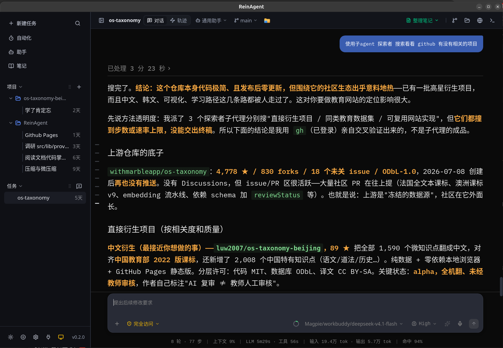

# ReinAgent

<p align="center">
  
</p>

<p align="center">
  <strong>高性能、自主可控的 Local-First 跨平台 AI 编程与桌面 Agent 工作台</strong>
</p>

<p align="center">
  
  
  
  
  
  
</p>

<p align="center">
  
</p>

---

## 🌟 核心理念与设计哲学

ReinAgent 致力于为开发者打造极致轻量、超高响应速度与 100% 自主可控的本地 AI 智能编程工作台。系统深度对标工业级顶级 AI 编程交互规范（融合 **ZCode** 的 UI/UX 与 **LiveAgent** 的底层工程架构）：

- **Local-First 数据自治**：所有会话历史、任务时间线、代码改动快照、模型密钥与配置均 100% 留存在本地（SQLite WAL + 本地 JSON），绝不上传云端，无任何中心化云服务依赖。
- **三端原生融合 & 绿色单文件即开即用**：针对 Linux (WebKitGTK)、Windows (WebView2) 和 macOS 进行深度原生适配；提供**免安装、免配任何环境（无需安装 Node.js / Python / Rust）的独立绿色单文件**，解压即跑。
- **No-Fallback & Fail-Fast（真实交互铁律）**：坚决拒绝静态硬编码猜测与虚假兜底掩盖。100% 真实解析服务端 API 返回的上下文窗口（`context_window`）、输出上限与多模态能力；网络或鉴权异常完整向用户报警，真实透明。
- **多智能体协作与持久上下文**：支持主智能体在复杂场景下派发独立子代理（Subagent）并行作业与任务隔离，结合本地长期记忆系统与动态水位线压缩，彻底杜绝单会话超长衰减。

---

## 🚀 核心特性全景

### 1. 三端原生适配与绿色单文件 (Cross-Platform & Portable)
- **绿色单文件 / 免安装即开即用**：
  - GitHub Releases 提供预编译绿色可执行文件（Linux AppImage / 可执行二进制、Windows 便携式 `.exe`、macOS 原生应用）；
  - **零环境依赖**：无需安装 Node.js、Python、Rust 等开发运行时，普通用户解压/双击直接运行。
- **三端底层深度融合**：
  - **Linux 专属优化**：支持 WebKitGTK 纯净渲染与 XWayland 原生窗口定位，支持通过 `xclip` / `wl-paste` 原生读取系统剪贴板图像，超长文本（≥15KB）自动转存为附件引用；
  - **Windows 专属优化**：WebView2 深度集成，控制台 GBK/UTF-8 字符集无损自适应转码，解决乱码难题；
  - **macOS 专属优化**：系统原生毛玻璃与圆角适配，无缝编译与稳定运行。
- **系统托盘与常驻生命周期**：
  - 支持关闭窗口最小化至系统原生托盘、后台静默运行；
  - 单实例守护机制（Single Instance Lock），防止重复开启多开冲突。

### 2. 多模式远程访问与安全公网隧道 (Remote Access)
- **三模网络架构自由切换**：
  - **局域网直连 (LAN)**：同一 Wi-Fi 内手机/平板/多设备直接扫码访问；
  - **Cloudflare 免配置安全公网隧道 (Cloudflare Quick Tunnel)**：
    - **无需公网 IP、免路由器端口映射、免注册任何账号**；
    - 后台自动拉起 Anycast 边缘安全隧道，生成全球合法的 `https://*.trycloudflare.com` 端到端加密域名；
    - 手机在任何地点使用 4G/5G 移动蜂窝网络直接扫码即连、实时审批与监控桌面 Agent。
  - **自定义公网域名 (Custom)**：支持配合个人 VPS 反向代理、FRP、Tailscale 绑定专属外部域名。
- **公网安全防护体系**：
  - **Fail2Ban 防爆破审计**：连续鉴权失败自动封禁异常 IP；
  - **真实 IP 穿透解析**：穿透 Cloudflare 边缘代理提取客户端真实公网 IP 进行安全审计；
  - **本地白名单保护**：严格豁免本地回环 `127.0.0.1` / `::1`，防止误拉黑本地代理导致服务瘫痪；
  - **世代守卫与进程回收**：内部采用进程世代守卫防状态竞争，应用退出时自动回收隧道子进程，防止孤儿进程暴露端口。
- **原生 MCP Server 挂载**：
  - 远控服务同时搭载标准 **Model Context Protocol (2024-11-05)** 协议端点（`GET /mcp/sse` 与 `POST /mcp/message`）；
  - 共享端口与 Token 鉴权，支持外部大模型（Claude Desktop、Cursor 等）直接远程调用并操控 ReinAgent。

### 3. 全链路出站网络代理规范 (Unified Proxy Architecture)
- **全站流量统一走代理**：
  - 只要在应用中配置 HTTP/SOCKS 代理，软件内所有出站请求（大模型 API 交互、远程模型列表拉取、自更新检查、云端实时语音 STT、Web 抓取、Cloudflare 隧道组件下载）均一律严格走代理出网；
- **免代理白名单直连支持**：
  - 遵循「不使用代理的地址」规则，匹配本地服务（`localhost`、`127.0.0.1`、内部 Ollama 服务等）自动直连，不绕行代理；
- **环境自动同步**：
  - 自动向 WebView2 / 内置浏览器及终端拉起的子进程环境变量同步代理设置，避免终端工具在墙内拉取依赖超时。

### 4. 多智能体协作与子代理派发 (Subagents)
- **并行任务拆解与上下文隔离**：
  - 主 Agent 可根据需求自动派发子智能体（如代码审查员、独立调研员、特定模块重构员）；
  - 独立会话隔离，防止主智能体上下文被海量调研或长日志直接污染与撑爆；
- **转录面板与回放交互**：
  - 对话流中的 `agent` 及 `subagent_output` 工具卡片支持一键点击交互；
  - 点击即可在工作台右侧副边栏唤起子代理会话面板，全屏查看子代理的思考链、工具执行轨迹与输出结果。

### 5. 本地长期记忆系统 (Long-term Memory System)
- **自动经验沉淀**：
  - 会话交互过程中自动提取用户的个人偏好、编码规范、技术栈习惯并持久化落盘；
- **分层作用域隔离**：
  - 支持**全局记忆 (Global Memory)** 与 **项目级独立记忆 (Project Memory)**，既保证跨项目通用习惯延续，又防止特定项目的专有业务逻辑污染其他项目；
- **智能重构与防遗忘**：
  - 具备记忆审查、合并组织与冲突解决机制，让 Agent 随着使用越发默契。

### 6. 自动化编排与周期任务 (Automation)
- **计划任务与条件触发**：
  - 支持创建自动化流水线与周期性任务（Cron 调度）；
  - 具备自动化执行记录、日志流追溯与即时手动触发（Run Now）能力。

### 7. 智能交互与会话流（对齐 ZCode）
- **双层输入胶囊（LexicalComposer）**：
  - 富文本编辑、`@` 快速引用上下文文件/符号、`/` 斜杠内置与自定义命令扩展；
  - 支持多图粘贴与拖拽，超长文本（≥15KB）自动转存为附件引用。
- **任务级独立模型记忆**：
  - 多任务窗口完全隔离，切换任务自动还原专属模型与推理等级，新建任务不产生配置污染。
- **Reasoning Effort 6 档联动**：
  - 支持 `Default / Low / Medium / High / XHigh / Max` 6 档推理强度，与大模型步数（100~600 steps）及协议参数严格映射。
- **对话问题导航条（ConversationNavigator）**：
  - 浮动于消息区左侧，以用户提问为刻度，支持悬停双段预览、山峰衰减视觉动效与平滑视口定位。
- **任务进度与结构化交互**：
  - **任务清单胶囊（TaskProgressBar）**：多份 Todo 计划支持并排展示、圆环进度动态推进与 Popover 展开；
  - **交互式提问（AskQuestionCard）**：模型主动提问（`ask_user`）改版为单弹窗多 Tab 体验，支持收起为输入框悬浮徽章。

### 8. Agent 运行回路与安全审批
- **精细化工具集与尺寸闸门**：
  - 核心内置工具：`read_file`（2000行/256KB 上限）、`write_file`、`edit_file`、`list_dir`（8KB）、`exec_command`（30KB 内联收集）；
- **四档审批模式（ApprovalMode）**：
  - `plan`（计划模式，只读调研拦截修改）、`ask`（变更前审批）、`edit`（自动放行编辑，执行命令弹窗）、`full`（完全访问直通）；
  - 基于 `beforeToolCall` 挂起机制，审批触发时 Agent 运行回路安全暂停，用户决策后即时恢复；
- **代码改动检查点与原子回退（Checkpoint & Rewind）**：
  - 文件修改前由 Rust 后端自动留存前像，UI 支持逐轮代码改动撤销，具备 SHA-256 指纹 TOCTOU 冲突防护。

### 9. 真实多协议接入、零猜测铁律与 OpenCodeZen 开箱即用
- **OpenCodeZen 专属免费模型通道（开箱即用，免配置 Key）**：
  - **默认免 Key 放行**：内置预设服务商 `OpenCodeZen`（Base URL 为 `https://opencode.ai/inference/v1`，默认 API Key 为 `public`），无需充值、无需绑定任何外部信用卡；
  - **一键动态拉取全部免费模型**：点击「🔄 刷新模型列表」即可直连官方 `/v1/models` 端点拉取并过滤所有可用免费模型（包含 `big-pickle` 及各类 `-free` 官方免费大模型序列）；
  - **全自动协议指纹与风控穿透**：运行时自动注入官方客户端规范的会话指纹（Session ID、有序请求 ID）与 5 大内置工具占位（`bash`, `edit`, `glob`, `grep`, `read`），强制原生流式（`stream: true`），彻底杜绝 `403 FreeTierError`，普通用户启动软件即可免费畅快使用！
- **动态模型刷新权威同步与自定义模型保护**：
  - 刷新模型时以官方返回为最新权威清单，自动清理失效或已更名的旧模型，杜绝历史冗余残留；
  - 严格保护用户手动添加的自定义模型（`isCustom: true`），绝不被误删；
  - 操作区视觉对齐：高亮翠绿的 `[当前默认]` 胶囊与常规灰色 `设为默认` 按钮在右侧同一列严格对齐，点击切换丝滑直观。
- **多协议原生适配**：支持 `Chat Completions (/chat/completions)`、`Anthropic Messages (/v1/messages)`、`Responses (/responses)` 与 `Google Generative AI (/models)` 协议；
- **Fail-Fast 连通性探测**：切换 API 格式即发起真实握手探测，Base URL 规范化清洗与自动追加 `/v1`；
- **主流预设与自定义端点**：预设 DeepSeek、OpenAI、Anthropic Claude、Google Gemini、OpenCodeZen、Ollama 等，并支持自由添加自定义兼容服务商。

### 10. 内置浏览器与 Web 自动化
- **无头与内嵌双模式**：
  - 支持内嵌浏览器页面导航、DOM 交互与状态调试；
  - 提供 `web_fetch` 与 `web_search` 网页阅读工具，自动将 HTML 清洗转换为结构化 Markdown 供模型深度分析；
  - 支持视口尺寸调节与页面视觉截图捕获。

### 11. 轨迹分析与请求预览（对齐 LiveAgent）
- **轨迹视图（TrajectoryView）**：
  - 对话顶部支持无缝切换「对话 / 轨迹」模式；
  - 提供三泳道时间轴（输入/模型/工具）、表格视图与 8 Tab 详情面板，精确呈现 TTFT 首包耗时、工具消耗与 Token 用量；
- **下一次请求预览**：
  - 与真实发送共享同源装配逻辑（`assembleTurnContext`），发送前即可完整预览系统提示词、工具定义、上下文结构与原始请求 JSON。

### 12. 上下文预算与防截断机制
- **微压缩（Microcompact）**：非侵入式裁剪历史工具结果文本块，不破坏磁盘与 UI 原始数据，确保报文不超限；
- **动态水位线**：基于 `contextWindow - maxOutputTokens` 计算真实可用空间（70% 水位线自动压缩），本地反代放宽至 32MB 护栏，根除超长会话断连。

### 13. 本地知识库与笔记本系统 (Notebooks & Knowledge Base, v0.2.0)
- **本地纯净 Markdown 物理映射**：
  - 数据持久化于用户家目录 `~/.ReinAgent/notebooks/`，首次启动自动生成 `default` 默认笔记本；
  - 零私有黑盒格式，每个笔记本对应一个物理文件夹，支持无限级嵌套子文件夹与即时检索；每篇笔记对应真实的 `.md` 文件，完美兼容 Obsidian、Typora 等外部工具协同编辑；
- **双栏交互工作台与目录树**：
  - 左侧常驻导航栏「笔记」（`BookOpen` 图标）快速切入；
  - 左栏呈现笔记本层级树、快速新建（`+ 笔记` / `+ 文件夹`）、搜索过滤框与笔记元信息列表（标题、字符数、修改时间、悬浮重命名与删除）；
- **所见即所得 Markdown 编辑器**：
  - 基于 Milkdown / ProseMirror 与 Nord 优雅主题，支持所见即所得流畅打字；
  - 支持 `预览 (Eye)` / `编辑 (Edit)` / `分栏 (Split)` 三态滑动胶囊自由切换；
  - 顶部常驻快捷格式工具栏（H2、H3、粗体、斜体、删除线、行内代码、引用块、无序/有序列表、任务待办、分割线、代码块），支持防抖自动保存落盘；
- **AI 写作助手（抽屉式侧弹窗）**：
  - 编辑器右上角一键唤出 AI 写作助手抽屉（`Sparkles` 图标），覆盖于右侧区域；
  - 提供全文重构、段落润色、代码解释、要点提炼、自定义提示词等强大指令；
  - 流式生成与 Token 耗时统计，支持「替换全文」与「在文末追加」精准更新编辑器内容；
- **任务对话一键整理笔记（OrganizeNotePanel）**：
  - 对话工作台顶栏右侧常驻 `[📄 整理笔记 ⌄]` 绿色胶囊按钮；
  - 展开即唤起轻量抽屉，支持选择目标笔记本（层级下拉）、自定义整理 Prompt，由当前任务关联模型深度分析完整对话历史；
  - 自动提炼任务目标、核心技术方案、踩坑记录与最终代码结论，自动生成高质量 Markdown 并保存为新笔记，支持一键跳转并打开该笔记。

### 14. 知识图谱与检索增强 (Knowledge Graph, v0.2.14)
- **LLM 抽取实体与关系**：
  - 设置 ▸ 知识库「图谱提取」区可按笔记逐篇或批量抽取（读全文 → 单轮模型 → 去重落库）；
  - 实体 5 类（概念 / 人物 / 组织 / 技术 / 项目），关系 5 类（属于 / 相关 / 依赖 / 包含 / 对比），模型输出的别名（`org`/`tech`/`belongs_to` 等）自动归一；
  - **去重铁律**：同名实体全局唯一（不区分大小写），同实体对 + 同类型关系的三元组只保留一条；
- **Canvas 力导向可视化**（侧栏「知识图谱」）：零依赖手写仿真（库仑斥力 + 弹簧 + 向心，alpha 衰减停机）；
  - 节点半径随关系数增长、按实体类型分色（读取 CSS 语义变量，随主题切换）；支持拖拽节点、滚轮缩放、点击查看详情、名称搜索与类型筛选；
  - 详情侧栏可删除实体 / 关系，并支持**合并重复实体**（关系自动改挂，自环与重复三元组自动清理）；
- **检索 1 跳增强**：语义检索命中笔记后，按图谱关系扩展出相邻实体关联的其他笔记一并返回（注入块带 `graph="1"` 标记、工具清单标「图谱扩展」，排在语义命中之后）；无图谱数据时完全不影响原链路；
- **来源回溯（v0.2.16）**：图谱关系与实体详情可「查看来源」，一键跳转对应笔记 / Wiki 页 / 导入会话；抽取范围扩展至笔记 + Wiki 页 + 导入会话三类源；
- **场景模型**：图谱抽取可用「设置 ▸ 通用 ▸ 场景默认模型 ▸ 图谱抽取」单独指定模型，未配置回退聊天默认；抽取用量计入「用量统计 ▸ 用量来源 ▸ 图谱抽取」。

### 15. PR / MR 评审闭环 (Pull Request Panel, v0.2.14)
- **自动平台适配**：按远端地址选 `gh`（GitHub）或 `glab`（GitLab）；CLI 未安装 / 未登录 / 远端不支持时如实提示安装命令与错误原文；
- **状态一屏可见**：PR 编号 / 标题 / 状态 / 草稿、`+N −N` 变更量、合并门禁（可合并 / 有冲突 / 被阻塞 / 落后 / 检查未全绿）、审查结论、逐项 CI 检查（分色，可点开日志）；
- **动作直达**：转正式 / 转草稿 / 合并（合并提交 · Squash · Rebase，可删分支）/ 关闭 / 重开；门禁未过或要求修改时合并按钮禁用并提示原因；
- **创建 PR**：标题 / 描述 / 目标分支（默认解析 origin/HEAD → main → master）/ 草稿，描述经 stdin 传递；
- **交给 Agent 修**：一键聚合失败与进行中的 CI、行内审查意见、失败日志摘录（≤2 条），组装为结构化指令**预填输入框**（不自动发送）。

### 16. 场景默认模型与用量可观测 (Scenario Models & Usage, v0.2.14)
- **场景默认模型**（设置 ▸ 通用）：聊天默认 / 知识库 Embedding / 记忆整理 / 笔记 AI / 图谱抽取 五行分别指定；
  - 读写各场景原有配置项（零迁移，与知识库页、记忆页同一份数据）；留空即跟随聊天默认并显示当前生效模型；
  - 绑定的服务商或模型被删 / 停用时自动回退聊天默认，并以警示色标注具体失效原因（服务商不存在 / 已停用 / 模型不存在 / 已停用）；
- **用量来源维度**：所有模型调用按来源记账——聊天、看板任务、定时任务（任务创建即打标）、子代理、笔记 AI、提示词增强、提交信息、记忆整理、图谱抽取、标题生成、知识库向量；
  - 新增「用量来源」视图：来源环形分布、来源 × 模型堆叠条、近 7 天 7×24 小时热力图；
  - **下钻与对比（v0.2.16）**：时间范围三档（7 天 / 30 天 / 全部）；点击堆叠条色段或来源行展开**逐次调用明细**（8 列 + 分页）；「对比上一期」按同长度窗口平移输出逐来源增减。
  - 口径：total = 输入 + 输出（缓存读写为独立分项）；响应未返回 usage 的调用不记账（绝不编造数值）。

### 17. Git 工作台与生态扩展
- **Git 工作台集成**：
  - 顶栏分支快速检出与新建、未暂存/已暂存行级差异对比；
  - 集成 AI 提交信息生成（`CommitDialog`）与空目录一键初始化仓库；
- **实时语音输入（STT）**：
  - 支持腾讯云、火山引擎、百度千帆、阿里 DashScope 实时语音 WebSocket 流式转写，输入框草稿无缝接续；
- **生态导入与双向 MCP 生态**：
  - 一键从 Claude Code、Codex、OpenCode、Pi 导入历史会话、模型配置、技能与 MCP 服务器；
  - **MCP 客户端**：接入外部任意标准 MCP 服务器（文件、终端、Puppeteer、GitHub 等）与 ClawHub 技能生态；
  - **原生内置 MCP 服务端**：遵循 MCP 2024-11-05 协议标准，通过 HTTP/SSE 原生暴露 15 个标准 Tools，外部大模型（Claude Desktop、Cursor 等）可像操作本地软件一样反向控制 ReinAgent（新建任务、查阅状态、文件读写、工具审批等）；
- **双配色主题**：
  - 内置 AntiGravity 与 OpenCode 两种消息配色体系，全系统遵循 Tailwind CSS v4 语义变量换肤。

### 18. SSH 远程项目 (SSH Projects, v0.2.15)
- **工作区即地址**：任务 / 看板卡片 / 定时任务的工作区直接填 `ssh://[user@]host[:port]/path`，Agent 的文件工具（列目录 / 读取 / 写入 / 编辑 / 删除 / glob / grep）、命令执行与终端全部作用于远端机器；
- **三态认证**：密钥 / agent / 密码（SSH_ASKPASS 注入，仅 Linux / macOS；Windows 如实提示）——密码保存于本地 0600 认证文件，不进任何远端与云；
- **连接管理**：侧栏「项目 ▸ +」→「SSH 连接…」表单（测试连接一键探活），支持从 `~/.ssh/config` 导入主机预填；
- **链路可靠性**：keepalive 5s×3 半死连接自检、60s 命令超时可读报错、沿用应用出网代理（HTTP CONNECT）；
- **Git 只读**：status / log / diff / branch 在远端执行，写操作如实拒绝；
- **v1 边界（不静默）**：SSH 工作区不支持检查点回退 / worktree / PR 面板 / Wiki 与知识库索引。

### 19. Skills Hub 技能中枢与上游更新追踪 (Skills Hub, v0.2.19)
- **4-Tab 极客技能管理架构**：
  - **Skills 管理 (Installed)**：管理已安装技能，支持全局/按任务多选启用/禁用、搜索与标签过滤、按名称/更新时间排序、抽屉式技能配置预览（查看描述、版本、作者、触发条件与完整提示词）及技能一键卸载；
  - **浏览榜单 (Explore)**：直连 skills.sh / ClawHub 开放生态，支持 All Time / Trending / Hot 榜单筛选、3 列卡片网格呈现与一键下载安装；
  - **本地安装 (Local)**：一键深度扫描本机 43 种主流开发工具（Claude Code、Codex、Cursor、Windsurf、OpenCode、Cline、Roo Code 等 43 款工具生态），毫秒级识别多达 768+ 个本机既有技能并支持一键导入；同时支持自定义本地文件夹或 ZIP 压缩包导入；
  - **Git 安装 (Git)**：支持输入任意外部 GitHub / GitLab / Gitee 仓库地址，实时预览技能元数据并一键克隆安装。
- **上游更新追踪与一键批量更新 (Update Tracking)**：
  - **智能来源分类**：自动识别并标记 `builtin`（内置）、`clawhub`（生态市场）、`git`（Git 仓库）、`local`（本地导入）四种技能来源；
  - **上游版本检测**：点击「🔄 检查更新」自动并发检测所有技能的上游最新版本/Commit，在卡片右上角呈现醒目的琥珀金脉冲微光徽标 `● 可更新`；
  - **一键平滑升级**：支持单技能抽屉/卡片快捷更新，或点击顶栏「✨ 一键更新 (N)」批量同步升级最新技能实现，更新后保留原有启用/禁用偏好。

### 20. 自动化会话复用、上下文容量自愈与生态健壮性 (v0.2.20)
- **自动化定时任务会话复用 (Automation Conversation Reuse)**：
  - **单会话长效沉淀**：定时自动化任务（如每日科技日报、定时巡检）默认开启「复用固定会话」模式，到点调度或手动“立即运行”自动在已有专属会话中接续推进，彻底根治同名会话刷屏问题；
  - **历史任务平滑接管**：智能识别同名存量历史会话并自动补齐双向绑定，支持在自动化编辑抽屉自由切换复用或每次新建；底层 SQLite 数据库自动无损升级。
- **上下文容量指示器中断自愈 (Context Usage Self-Healing)**：
  - 彻底解决中途停止消息或空用量中断冲刷上一轮容量的缺陷；倒序精准锁定最近一轮真实消耗，输入框上方圆形百分比与底栏 Token 统计始终稳定展示。
- **离线与故障 MCP 服务 Fail-Fast 保底呈现**：
  - 未挂载设备或启动异常的 MCP 服务在斜杠快捷指令（`/`）中保持透明可见，以琥珀色 `[MCP · <id> · 离线]` 警示徽标与真实报错提示，恪守真实透明原则。
- **助手级白名单精确收敛**：
  - 对齐全局默认助手与任务关联助手，斜杠命令精准根据生效助手的白名单过滤展示可用工具与技能，避免全局越界混淆。

---

## 🏗️ 系统架构

```
ReinAgent 架构全景
├── Frontend (React 19 + TypeScript + Tailwind CSS v4)
│   ├── src/App.tsx                      # 根容器、全局快捷键、主视口分流 (Workbench / Notes / Settings)
│   ├── src/store/useAppStore.ts         # 全局响应式状态 (主题、语言、任务、工作区项目)
│   ├── src/components/
│   │   ├── chat/                        # 输入胶囊、消息流、回合分组、审批卡、导航条、子代理卡片、整理笔记面板
│   │   ├── notes/                       # 笔记本双栏工作台、目录树、Milkdown 编辑器、AI 写作助手抽屉
│   │   ├── trajectory/                  # 轨迹视图、时间轴泳道、详情面板
│   │   ├── git/                         # 分支切换器、Git 图谱、提交对话框
│   │   ├── sidebar/                     # 侧边栏主体、项目与任务树、长按拖拽重排
│   │   └── settings/                    # 模型服务商、语音输入、导入工作台、远程访问、代理设置
│   └── src/lib/
│       ├── chat/                        # conversationPool (会话池), conversationModel (状态机)
│       ├── providers/                   # runAgentTurn, modelFactory, assembleTurnContext
│       ├── storage/                     # db.ts (SQLite 内存缓存 + 防抖写透)
│       ├── remote/                      # remoteBridge.ts 手机远控与 MCP 双向桥接
│       └── agent/                       # agentRuntime, 核心工具集, 路径决议
│
└── Backend (Tauri 2 / Rust)
    └── src-tauri/src/
        ├── lib.rs                       # Tauri 命令注册、应用生命周期与退出钩子
        ├── notes_fs.rs                  # 纯净 Markdown 笔记本树形遍历、文件读写与元数据服务
        ├── conversation_store.rs        # SQLite (WAL) 会话与任务持久化
        ├── checkpoint.rs                # 检查点创建、差异比对与代码原子回退引擎
        ├── fs_cmd.rs                    # 异步受控文件操作、原生文件夹选择、系统管理器调起
        ├── git_panel.rs                 # Git 分支、状态、提交与推送命令
        ├── remote_server.rs             # 远程 Axum HTTP/WebSocket 远控服务与真实 IP 审计
        ├── mcp_server.rs                # 原生内置 MCP Server（SSE + JSON-RPC，15 项能力直通）
        ├── remote_tunnel.rs             # Cloudflare Quick Tunnel 世代守卫与安全下载管理
        ├── app_proxy.rs                 # 全局出站网络代理配置注入与白名单校验
        ├── browser.rs                   # 内置无头/内嵌浏览器控制与截图
        ├── terminal.rs                  # 跨平台伪终端 (PTY) 会话管理
        └── clipboard_image.rs           # Linux 剪贴板原生图像读取适配
```

---

## 📦 技术栈与依赖

- **前端框架**：React 19 + TypeScript 6 + Vite
- **样式与组件**：Tailwind CSS v4 + Radix UI 原语 + Lucide Icons + Motion
- **编辑器与渲染**：Milkdown (ProseMirror 所见即所得 Markdown) + Lexical 富文本 + Marked + Shiki (代码高亮) + @pierre/diffs
- **虚拟化与状态**：@tanstack/react-virtual + Zustand
- **桌面与后端**：Tauri 2 (Rust) + Axum + SQLite (rusqlite) + Tokio
- **包管理器**：[Bun](https://bun.sh) (`bun@1.4.2`)

---

## 💻 环境要求

### 普通用户（直接运行）
- **下载即用**：直接前往 [Releases 页面](../../releases) 下载对应系统的绿色安装包或单文件，**无需安装任何运行时**。
- **支持操作系统**：
  - **Linux**：Ubuntu 22.04+ / Debian 12+ / Arch / Fedora 等（主流发行版均已内置 `webkit2gtk`）；
  - **Windows**：Windows 10 / 11（自带 Microsoft Edge WebView2 运行时）；
  - **macOS**：macOS 12 Monterey 及以上。

### 开发者（二次开发与编译）
- [Bun](https://bun.sh) ≥ 1.1（建议严格使用 `bun@1.4.2`）
- [Node.js](https://nodejs.org) ≥ 20（用于运行部分 Node 原生测试）
- [Rust](https://rustup.rs) (stable)

---

## 🛠️ 快速上手（开发者）

### 1. 安装依赖
```bash
bun install
```

### 2. 开发模式运行
启动前端开发服务器与 Tauri 桌面窗口：
```bash
bun run tauri dev
```

### 3. 代码验证与单元测试
ReinAgent 配备了严谨的分域单元测试矩阵：

```bash
# 执行全部关键子领域前端测试
bun run test:chat               # 会话模型、控制器、导航条、状态机测试
bun run test:providers          # 模型工厂、审批门、工具策略测试
bun run test:agent              # Agent 运行时、工具集、工作区路径决议测试
bun run test:git                # Git 分支切换与冲突处理逻辑测试
bun run test:hub                # 技能中心与 MCP 注册表测试
bun run test:settings           # 设置项持久化测试
bun run test:markdown           # Markdown 渲染块解析测试
bun run test:assistants         # 助手人设解析测试
bun run test:import             # 外部生态会话与配置导入测试
bun run test:promptEnhancement  # 提示词增强模板与流式生成测试

# 全局 TypeScript 类型检查
bun run tsc --noEmit

# Rust 后端类型与命令检查
cargo test --manifest-path src-tauri/Cargo.toml
```

### 4. 生产打包构建
```bash
# 构建正式可分发安装包 (产物输出至 src-tauri/target/release/bundle/)
bun run tauri build
```

---

## 📁 目录结构

```
ReinAgent/
├── src/                          # 前端源代码
│   ├── assets/                   # 静态字体、图标等资源
│   ├── components/               # React UI 组件 (chat, settings, sidebar, git, trajectory 等)
│   ├── hooks/                    # 通用 React Hooks
│   ├── i18n/                     # 中英双语国际化字典
│   ├── lib/                      # 核心业务逻辑 (agent, chat, providers, git, stt, storage 等)
│   ├── preview/                  # 右侧代码与差异预览面板组件
│   ├── store/                    # Zustand 全局 Store (useAppStore.ts)
│   ├── styles/                   # 全局样式与 CSS 语义主题变量 (global.css)
│   ├── App.tsx                   # 顶层工作台与视图路由
│   └── main.tsx                  # 应用入口与数据存储初始化
├── src-tauri/                    # Tauri 2 / Rust 后端
│   ├── src/                      # Rust 核心模块 (存储, 检查点, 文件, Git, 远控, 代理, PTY 等)
│   ├── icons/                    # 各分辨率桌面图标
│   ├── Cargo.toml                # Rust 依赖声明
│   └── tauri.conf.json           # Tauri 应用配置
├── docs/                         # 项目文档专区
│   ├── PROJECT_CONTEXT.md        # 核心全景架构白皮书 (Single Source of Truth)
│   ├── PROMPTS.md                # 系统提示词单一真相源
│   ├── assets/                   # 界面静态资产与高清实测演示图
│   └── archived/
│       └── ROADMAP.md            # 历史功能路线图归档
├── AGENTS.md                     # Agent 工作区指令与规则单一真相源
├── LICENSE                       # MIT 开源协议
└── package.json                  # 项目依赖与运行脚本
```

---

## 🔒 隐私与本地数据说明

- **配置存储**：模型 API Key 存储在本地文件 `~/.ReinAgent/provider_config.json`，不会上传任何三方服务器。
- **对话与任务库**：任务元数据与时间线持久化在本地 SQLite 数据库 `~/.ReinAgent/conversations.db`。
- **代码检查点**：代码修改前快照保存在 `~/.ReinAgent/checkpoints/<taskId>/`，仅供本机会话回退使用。
- **知识库与笔记本**：纯净 Markdown 文件持久化在 `~/.ReinAgent/notebooks/`（多层物理文件夹与真实 `.md` 映射）。
- **默认工作区**：未指定项目时，默认在 `~/.ReinAgent/DefaultProject/` 开展工作。

---

## 🤝 社区认可与友情链接

- [LINUX DO](https://linux.do/) - 新的理想型社区

---

## 📄 开源许可证

本项目基于 [MIT License](LICENSE) 开源。
